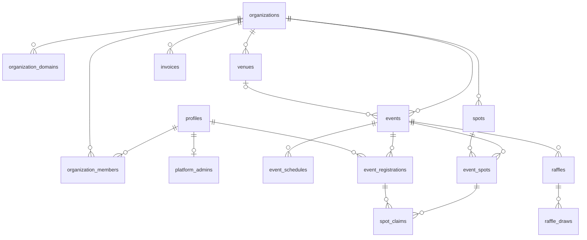

# Eventdex — Proyecto

`v0.3 · 2026-11-07` · Relacionados: [PRODUCT](./PRODUCT.md) · [ARQUITECTURA](./ARQUITECTURA.md) · [RUTAS](./RUTAS.md) · [ROADMAP](./ROADMAP.md)

> Contexto general. Si algo de acá choca con un documento más específico, manda el
> específico y este se corrige en el mismo cambio.

## Visión

Eventdex convierte un evento presencial en un juego de colección. El visitante
recorre el predio, escanea los QR de stands y atracciones y junta medallas. Al
cierre, el organizador sortea premios entre quienes participaron.

Se vende a **organizaciones** (productoras, municipios, expos). Cada una administra
sus eventos y los publica en **su propio dominio**, todos contra un solo deployment.

### Por qué se rehace desde cero

La v2 (Astro + Next + monorepo) resolvió el modelo de datos, pero llegó a la etapa
del admin con dos runtimes, un diseño que no convence y un esquema que se armó
antes de tener pantallas que lo usaran. Esta vez el orden se invierte: cada tabla
nace junto con la vista que la usa (ver [ROADMAP](./ROADMAP.md)).

De la v2 se conservan las **ideas** que funcionaron, no el código:

- Catálogo de spots reutilizable entre ediciones (`spots` + `event_spots`).
- `status` editorial separado de la **fase** temporal, que se calcula y nunca se guarda.
- Autorización en la base (RLS), no en el código con la service key.
- Registro explícito del visitante al evento.
- `timestamptz` en todo; la zona del evento se usa solo para mostrar.

El código de la v2 queda en git con el tag `v2-legacy`, como referencia para la
migración de datos.

## Perfiles de uso

| Perfil | Quién es | Alcance | Dónde usa Eventdex |
|--------|----------|---------|--------------------|
| **Visitante** | Persona que va al evento | Los eventos en los que se registró | Celular, en el predio, con una mano |
| **Staff** | Miembro operativo de la organización | Su organización | Admin, desde notebook o celular |
| **Owner** | Dueño de la organización | Su organización, con miembros, marca y dominio | Admin |
| **Developer** | Vos: soporte, alta de orgs, facturación | Toda la plataforma | Panel de plataforma; entra a cualquier org en modo soporte (solo lectura, auditado) |

**El admin es por organización.** Un organizador entra y cae en el panel de su
org; hoy tiene una sola (el modelo admite varias, con un selector). La invitación
se acepta sola al entrar con el mismo mail. Sin organización no hay acceso al
panel: la cuenta puede existir igual, porque es la misma que usa el visitante.

**Fuera de esta versión:** el expositor (quien atiende un stand y edita sus datos).
El modelo no le cierra la puerta, pero no tiene tablas ni pantallas todavía.

## Módulos

| # | Módulo | Perfil | Qué incluye |
|---|--------|--------|-------------|
| 1 | **Organización** | Owner | Alta de la org (por el developer), miembros, marca, dominio |
| 2 | **Eventos** | Staff / Owner | Evento, jornadas, sede, publicación |
| 3 | **Catálogo y QR** | Staff / Owner | Spots del catálogo, spots del evento, códigos e impresión de QR |
| 4 | **App del visitante** | Visitante | Portada del evento, login, escaneo, medallas, progreso, perfil |
| 5 | **Sorteo** | Staff / Owner | Elegibles, extracción, anulación, ganadores |
| 6 | **Plataforma** | Developer | Organizaciones, dominios, facturación manual, auditoría |
| 7 | **Landing** | Público | Marketing de eventdex.com |
| 8 | **Migración** | Developer | Importar datos de v1 y v2 al esquema nuevo |

## Glosario

Si un concepto se llama de una forma acá, se llama igual en la base, en el código y
en la interfaz (en la interfaz, en castellano).

| Término | Significado | Tabla |
|---------|-------------|-------|
| Organización | Cliente de Eventdex | `organizations` |
| Dominio | Hostname que sirve la app pública de una org | `organization_domains` |
| Miembro | Persona del equipo de una org, con rol | `organization_members` |
| Invitación | Pedido para sumarse a una org, por mail, antes de tener cuenta | `organization_invitations` |
| Sede | Lugar físico reutilizable entre ediciones | `venues` |
| Evento | Una edición concreta: "Expo Ubbe 2026" | `events` |
| Jornada | Bloque horario de un evento | `event_schedules` |
| Spot | Stand o atracción del **catálogo** de la org | `spots` |
| Spot del evento | Un spot puesto en un evento; es lo que apunta el QR | `event_spots` |
| Registro | Un visitante inscripto a un evento | `event_registrations` |
| Reclamo | Un escaneo válido. En la interfaz, **medalla** | `spot_claims` |
| Sorteo | Un premio a sortear dentro de un evento | `raffles` |
| Extracción | Una tirada del sorteo, con su ganador | `raffle_draws` |
| Fase | Próximo / en curso / finalizado. Se calcula | *(vista)* |

## Modelo de datos inicial

Es un punto de partida, no un esquema cerrado. Cada tabla se crea en el bloque
**DB** de la rebanada que la necesita, con sus permisos y tests, y ahí se fijan las
columnas. Las convenciones (nombres, `uuid`, `timestamptz`, baja lógica, dinero en
centavos) van en [ARQUITECTURA](./ARQUITECTURA.md).

| Tabla | Para qué | Decisiones clave |
|-------|----------|------------------|
| `profiles` | Espejo de `auth.users` | Se crea por trigger al registrarse |
| `platform_admins` | Quién es developer | Tabla aparte: el acceso es cross-org |
| `organizations` | El cliente | `slug`, `brand_color` (hex: de ahí sale la rampa), `logo_path`, zona horaria por defecto, `status`. El owner edita nombre, color, logo y zona; slug y estado, solo el developer |
| `organization_domains` | Hostnames por org | Tabla y no columna: apex + `www` y cambios de dominio sin downtime. Uno `is_primary` |
| `organization_members` | Equipo de la org | Solo miembros activos: quitar es borrar (queda en `audit_logs`). Rol `owner` / `staff`. No se puede quitar ni degradar al último owner |
| `organization_invitations` | Invitaciones por mail | La membresía nace al aceptar (`accept_invitation`), si el mail de la cuenta coincide. Vencen a los 14 días |
| `venues` | Sedes | Definen la zona horaria que hereda el evento |
| `events` | Ediciones | `status` editorial (`draft` → `published` → `archived` / `cancelled`), `settings jsonb` |
| `event_schedules` | Jornadas | `starts_at` / `ends_at` en `timestamptz`; de acá sale la fase |
| `spots` | Catálogo de la org | Viven sin evento; se archivan, no se borran |
| `event_spots` | Spot dentro de un evento | Overrides por edición, `code` corto, `points`, `snapshot` congelado al publicar |
| `event_registrations` | Visitante ↔ evento | Único por (evento, usuario); ancla de RLS y de bloqueos |
| `spot_claims` | Medallas | Único por (spot del evento, usuario): escanear dos veces no duplica |
| `raffles` / `raffle_draws` | Sorteos y extracciones | Varias extracciones por sorteo; una extracción se anula, no se borra |
| `invoices` | Facturación manual | Por organización, monto en centavos, estado |
| `audit_logs` | Rastro de acciones sensibles | Toda acción cross-org del developer deja registro |

**Lo que se saca respecto de la v2** (cada uno vuelve solo si una rebanada lo pide):

- `event_series`: el vínculo entre ediciones se resuelve con **duplicar evento**. Si
  aparece una métrica entre ediciones que lo necesite, vuelve.
- `event_members` y `event_spot_exhibitors`: no hay roles por evento ni expositor
  en esta versión.
- La vista de cohortes (visitantes nuevos vs. recurrentes) pasa a la rebanada de
  métricas, si entra.

## Preguntas abiertas

1. **Login del visitante**: ¿alcanza con Google o hace falta un link mágico por mail?
   No todos los visitantes tienen o quieren usar Google.
2. **Escaneo**: ¿cámara dentro de la app, la cámara nativa del celular abriendo la
   URL del QR, o las dos?
3. **Sorteo en vivo**: ¿se proyecta en pantalla durante el evento? Si es así, hace
   falta una vista de presentación.
4. **Meta de medallas**: ¿para entrar al sorteo hay que juntar un mínimo, o alcanza
   con una?
5. **Duplicar evento**: ¿copia spots, sede y jornadas, o solo spots?
6. **Facturación**: ¿se factura por evento o por período a la organización?
7. **Migración**: ¿qué se migra de la v1 (solo visitantes y medallas, o también
   eventos pasados)? ¿Los usuarios conservan su login?
